# Enroll Course — Business Logic

Since 4.5.1 the enroll request goes through AJAX `UserCourseAjax` (web) and JWT API `learnpress/v1/courses/enroll` (app); both call `UserCourseService::enroll()`. REST API `lp/v1/courses/enroll-course` and `enrollCourse()` in `assets/src/apps/js/frontend/single-course.js` are deprecated (commented out).

```mermaid
flowchart TD
    Start([Open single course page]) --> Render[SingleCourseTemplate::html_btn_enroll_course]
    Render --> CanEnroll{CourseModel::can_enroll succeeds?}
    CanEnroll -->|No| ShowCode{Error code in filter learn-press/course/html-button-enroll/show-messages?}
    ShowCode -->|Yes| Warning[Render warning message, default codes course_is_no_required_enroll_not_login, course_out_of_stock]
    ShowCode -->|No| Empty([Return empty output])
    CanEnroll -->|Yes| LegacyFilter{Legacy filter button-enroll/can-show allows button?}
    LegacyFilter -->|No| Empty
    LegacyFilter -->|Yes| StartNow[Render form.enroll-course with data-lp-action-nonce, Start Now button with data-send, enqueue lp-single-course-v2]

    StartNow --> Submit[User submits enroll form]
    Submit --> HasSend{Start Now button has data-send?}
    HasSend -->|No, old template| NotHandled([Form is not handled by JS])
    HasSend -->|Yes| JS[SingleCourse::enrollCourse prevents submit]
    JS --> Busy{Request running or button disabled?}
    Busy -->|Yes| Skip([Nothing sent])
    Busy -->|No| Fetch[lpAJAXG.fetchAJAX: data-send, action user_enroll_course, lp_action_nonce]
    Fetch --> Ajax0[POST lp-load-ajax=user_enroll_course]
    Ajax0 --> Allowed0{Action declared in UserCourseAjax::$actions?}
    Allowed0 -->|No| Ignore([Request ignored])
    Allowed0 -->|Yes| WpRest{wp_rest nonce valid?}
    WpRest -->|No| NonceRetry[Header X-LP-Nonce-Invalid, JS refreshes nonce and retries once]
    NonceRetry --> Ajax0
    WpRest -->|Yes| LoggedIn{User logged in?}
    LoggedIn -->|Yes| ActionNonce{lp_action_nonce valid for lp_user_course_nonce?}
    ActionNonce -->|No| AjaxError[Return error message]
    ActionNonce -->|Yes| Handler0[UserCourseAjax::user_enroll_course]
    LoggedIn -->|No - guest, action nonce skipped| Handler0
    Handler0 --> Params{Data JSON, course_id and course valid?}
    Params -->|No| AjaxError
    Params -->|Yes| FindUser[UserModel::find current user, false for guest]
    FindUser --> Service[UserCourseService::enroll]

    App([App calls POST learnpress/v1/courses/enroll]) --> AppLogin{JWT user logged in?}
    AppLogin -->|No| App401([401 Please login to continue])
    AppLogin -->|Yes| AppHandler[LP_REST_Courses_V1_Controller::enroll_course]
    AppHandler --> AppCourse{Course id valid?}
    AppCourse -->|No| AppError([Return status error, Invalid course])
    AppCourse -->|Yes| Service

    Service --> Password{Password protected and user can not edit_post?}
    Password -->|Yes| ServiceError[Throw error message]
    Password -->|No| CanEnroll2{CourseModel::can_enroll succeeds?}
    CanEnroll2 -->|No| ServiceError
    CanEnroll2 -->|Yes| Purchased{User logged in and user course has_purchased?}

    Purchased -->|Yes| SetEnrolled[Set user course status enrolled, graduation in-progress, start_time now, save]
    SetEnrolled --> EnrolledHook[Fire learnpress/user/course-enrolled]
    EnrolledHook --> Mail[LPBackgroundAjax send_mail_user_enrolled_course]
    Mail --> UserResult

    Purchased -->|No, free course| EmptyCart[Empty cart]
    EmptyCart --> AddCart[Add course to cart]
    AddCart --> Added{Cart item created?}
    Added -->|No| ServiceError
    Added -->|Yes| GuestCheck{User logged in?}
    GuestCheck -->|Yes| CreateOrder[LP_Checkout::create_order]
    CreateOrder --> Total{Order total greater than 0?}
    Total -->|Yes| PaidBlock[Empty cart, throw Invalid enrollment: the order total is not zero]
    PaidBlock --> ServiceError
    Total -->|No| Complete[LP_Order::payment_complete, status completed]
    Complete --> StatusChanged[learn-press/order/status-changed, LP_User_Factory creates Enrolled user course, fires course-enrolled and emails]
    StatusChanged --> EmptyCart2[Empty cart]
    EmptyCart2 --> UserResult
    GuestCheck -->|No - guest| GuestRedirect[Filter learnpress/rest-api/courses/enroll/redirect with checkout URL]
    GuestRedirect --> HasURL{Checkout page configured?}
    HasURL -->|No| ServiceError
    HasURL -->|Yes| GuestResult[Return message Redirecting and no-cache checkout URL]

    UserResult[Return message Congrats and first item link, or course permalink when no items]

    UserResult --> Success[Return status success, message, data.redirect]
    GuestResult --> Success
    ServiceError --> AjaxError

    Success -->|Web| FrontSuccess[JS hides button, shows decoded message, sets location.href]
    Success -->|App| AppSuccess([App receives redirect])
    AjaxError -->|Web| FrontError([JS shows error on .lp-ajax-message or toast, enables button again])
    AjaxError -->|App| AppErrorResp([App receives status error and message])

    FrontSuccess --> Redirect{Redirect target}
    Redirect -->|Logged-in user| Learn([Learning page of first item or course page])
    Redirect -->|Guest| Checkout([Checkout page, see purchase-course-code.md checkout flow])

    Back([User presses Back to single course]) --> BackCache{Page restored from cache: persisted or navigation back_forward?}
    BackCache -->|Yes| Reload([SingleCourse::reloadWhenBackForward reloads page to update buttons])
    BackCache -->|No| NoReload([Nothing])
```

## Authoritative entry points

- `SingleCourseTemplate::html_btn_enroll_course()` renders `form.enroll-course` (attribute `data-lp-action-nonce`) and the Start Now button (`data-send`: `action` `user_enroll_course`, `course_id`), and enqueues `lp-single-course-v2`.
- `SingleCourse::enrollCourse()` (`assets/src/js/frontend/single-course.js`) handles the form submit and sends the request via `window.lpAJAXG.fetchAJAX`; `SingleCourse::reloadWhenBackForward()` reloads the single course page restored from the browser cache.
- `AbstractAjax::catch_lp_ajax()` checks the allowed action and the `wp_rest` nonce; `UserCourseAjax::verify_action_nonce()` checks `lp_action_nonce` for logged-in users only.
- `UserCourseAjax::user_enroll_course()` validates the course and calls the service (user is `false` for guest).
- `LP_REST_Courses_V1_Controller::enroll_course()` (JWT, `permission_callback` `get_course_need_login_check`) validates the course and calls the service.
- `UserCourseService::enroll()` checks password protection and `can_enroll`, enrolls a purchased user course or completes a free order, and returns the message and redirect (checkout page for guest).
- `LP_Order::payment_complete()` sets the order completed; `LP_User_Factory` handles `learn-press/order/status-changed` and creates the enrolled user course (see `purchase-course-code.md`).
