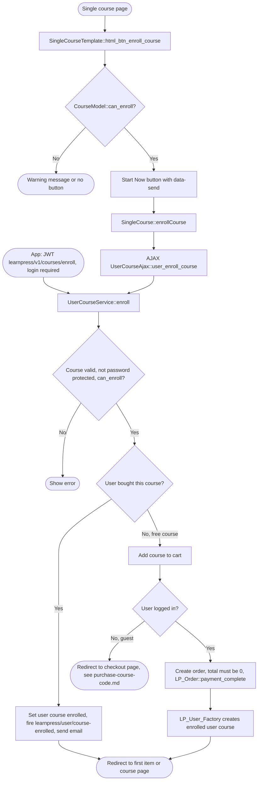

# Enroll Course — Business Logic

## Entry points

- `SingleCourseTemplate::html_btn_enroll_course()`: renders the Start Now button.
- `SingleCourse::enrollCourse()` (`assets/src/js/frontend/single-course.js`): sends AJAX, redirects on success.
- `UserCourseAjax::user_enroll_course()` (web) and `LP_REST_Courses_V1_Controller::enroll_course()` (app) → `UserCourseService::enroll()`: validates and enrolls.
- `LP_Order::payment_complete()` → `LP_User_Factory` on `learn-press/order/status-changed`: creates the enrolled user course for a free course.

Since 4.5.1 REST `lp/v1/courses/enroll-course` is deprecated (replaced by AJAX `user_enroll_course`).
