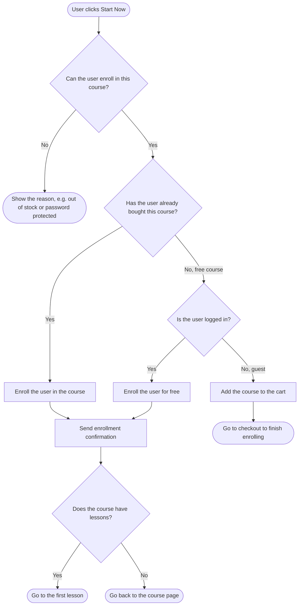

# Enroll Course — Human-readable Logic

## Cases

| Case | Result | Go to |
|---|---|---|
| Cannot enroll (out of stock, password protected...) | Show the reason | Stay on the course page |
| Already bought the course | Enrolled, confirmation email sent | First lesson (or course page if no lessons) |
| Free course, logged in | Enrolled for free, confirmation email sent | First lesson (or course page if no lessons) |
| Free course, guest | Course added to the cart | Checkout page |

See `enroll-course-code.md` for the code flow.
