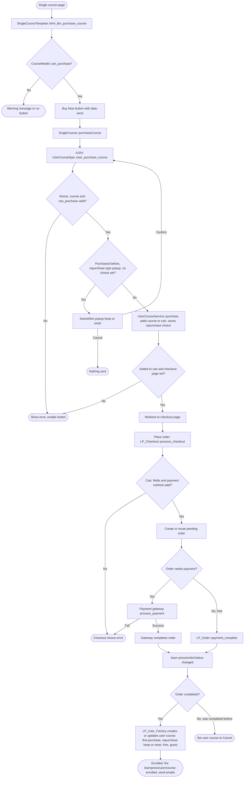

# Purchase Course — Business Logic

## Entry points

- `SingleCourseTemplate::html_btn_purchase_course()`: renders the Buy Now button.
- `SingleCourse::purchaseCourse()` (`assets/src/js/frontend/single-course.js`): sends AJAX, shows the repurchase popup.
- `UserCourseAjax::user_purchase_course()` → `UserCourseService::purchase()`: validates, adds to cart, returns checkout URL.
- `LP_Checkout::process_checkout()`: validates checkout, creates the order, starts payment or completes a free order.
- `LP_User_Factory`: on `learn-press/order/status-changed`, grants or cancels course access.

Since 4.5.1 REST `lp/v1/courses/purchase-course` is deprecated (replaced by AJAX `user_purchase_course`).
