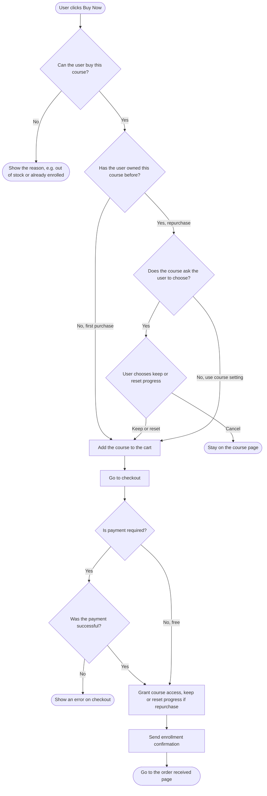

# Purchase Course — Human-readable Logic

## Cases

| Case | Result | Go to |
|---|---|---|
| Cannot buy (out of stock, already enrolled...) | Show the reason | Stay on the course page |
| First purchase | Course added to the cart | Checkout page |
| Repurchase, course asks to choose | User chooses keep or reset progress, course added to the cart | Checkout page (cancel: stay on the course page) |
| Repurchase, course setting decides | Course added to the cart with the setting keep or reset | Checkout page |
| Checkout, payment successful or free | Course access granted, confirmation email sent | Order received page |
| Checkout, payment failed | Show an error | Stay on checkout |

See `purchase-course-code.md` for the code flow.
